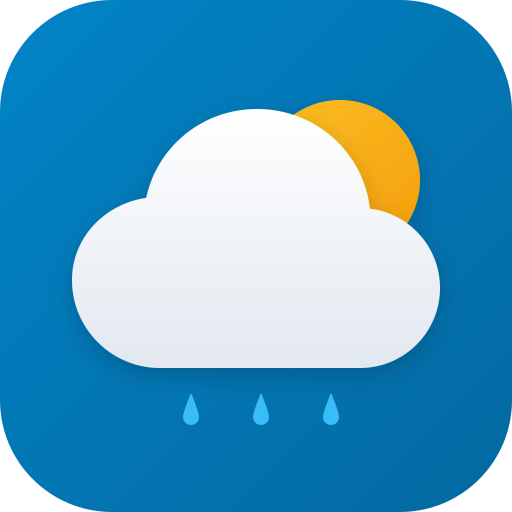
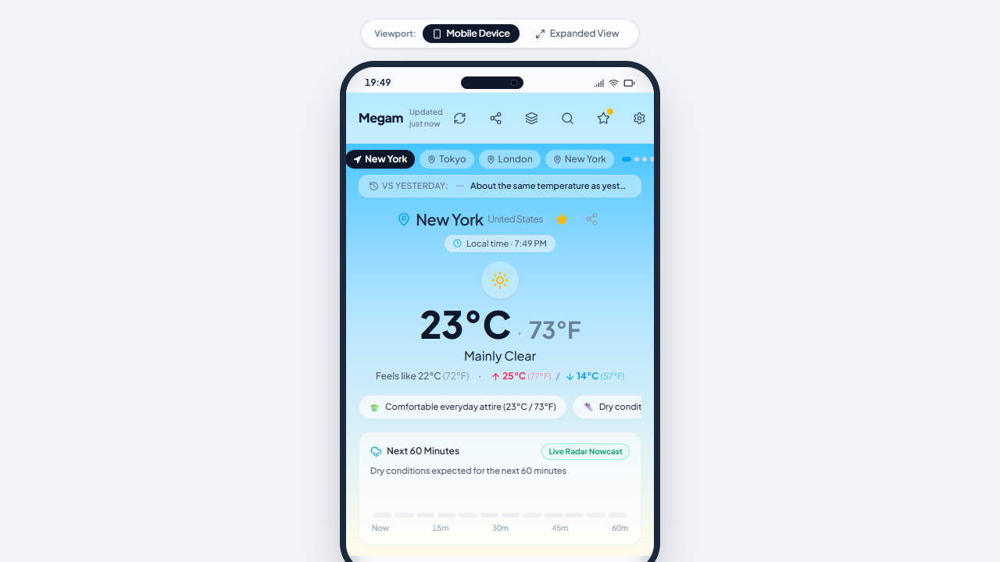
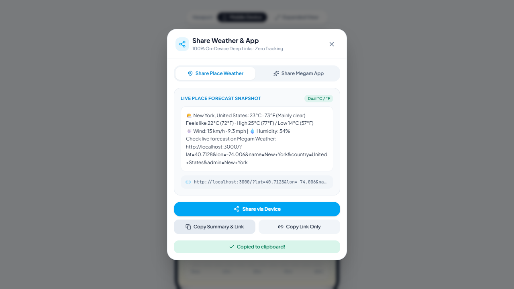
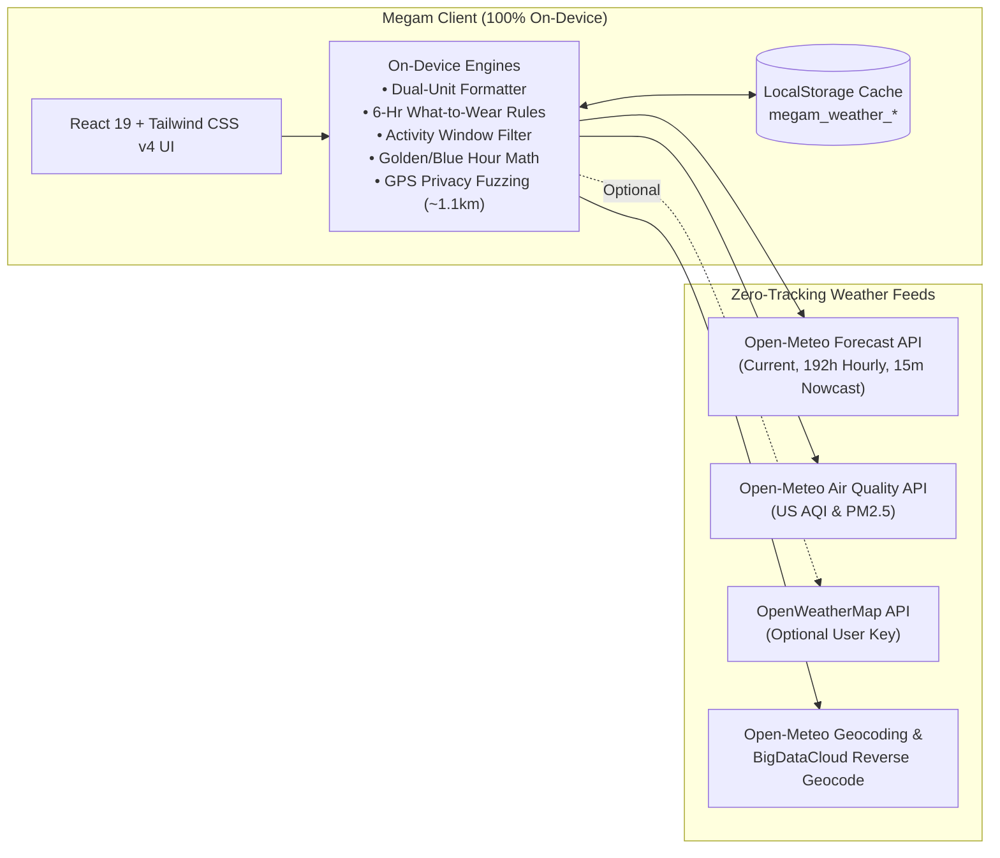

<div align="center">



# Megam Weather (v2.1.1)

**The 100% On-Device, Privacy-First Dual-Unit Weather Companion (`°C` & `°F` Simultaneously)**

[](src/version.ts)
[](https://react.dev/)
[](https://www.typescriptlang.org/)
[](https://tailwindcss.com/)
[](https://capacitorjs.com/)
[](LICENSE)

*Built for global travelers, expats, outdoor athletes, and privacy-conscious users who think in both Metric and Imperial — delivering instant forecasts, 15-minute live radar nowcasting, UV & Air Quality health intelligence, and zero cloud tracking.*

[Key Features](#-key-features) • [App Screenshots](#-app-screenshots) • [Architecture](#-technical-architecture--stack) • [Quick Start](#-quick-start--development) • [Testing (TDD)](#-testing--quality-assurance-tdd) • [Android APK](#-building-the-native-android-apk) • [Deployment](#-deploying-to-vercel)

</div>

---

## 📸 App Screenshots

<div align="center">
<table>
  <tr>
    <td align="center" width="33%">
      
      <br />
      <sub><b>1. Dual-Unit Forecast Dashboard</b><br />Simultaneous °C & °F, Local Destination Clock, What-to-Wear Strip, and 60-Min Live Radar Nowcast</sub>
    </td>
    <td align="center" width="33%">
      
      <br />
      <sub><b>2. Share Place Weather & App</b><br />Zero-tracking deep links (`?lat=...&lon=...`) & formatted dual-unit weather cards via native Web Share</sub>
    </td>
    <td align="center" width="33%">
      
      <br />
      <sub><b>3. Dark Mode & Activity Thresholds</b><br />Custom Run/Walk/Bike comfort rules, Neighborhood-Only GPS Privacy Shield, & Zero-Cloud Backup</sub>
    </td>
  </tr>
</table>
</div>

---

## ✨ Key Features

| Category | Feature | Description |
| :--- | :--- | :--- |
| **🌡️ Dual-Unit Core** | **Simultaneous `°C` & `°F` Hierarchy** | Displays both Celsius and Fahrenheit everywhere (Current Hero, Hourly Strip, 7-Day High/Lows, What-to-Wear, and Widgets). Choose your **Primary Unit** (`100%` scale/opacity) while keeping the secondary unit simultaneously visible (`60%` opacity). |
| **🌧️ Hyperlocal Nowcast** | **Real 15-Min Radar Nowcasting** | Queries Open-Meteo `minutely_15` precipitation data and interpolates 5-minute intensity bars for the next 60 minutes, badged clearly as **`Live Radar Nowcast`** vs. **`Hourly Trend Estimate`**. |
| **🧥 Smart Assistant** | **"What to Wear / Bring" Strip** | Deterministic on-device rule engine scanning the next 6 hours to surface up to 3 actionable chips: umbrella alerts with exact rain hour, jacket layering for temperature drops, UV protection (`UV ≥ 6`), and high-wind warnings. |
| **🫁 Health & Safety** | **UV Index & Air Quality (`US AQI` / `PM2.5`)** | Parallel queries to Open-Meteo's Air Quality API display color-coded EPA AQI badges (`Good` to `Hazardous`), `PM2.5` concentration, and WHO UV Index categories — automatically filtering smoky (`AQI > 100`) or extreme-UV (`UV > 7`) hours from outdoor activity recommendations. |
| **🏃 Outdoor Optimizer** | **Custom Activity Windows (Run / Walk / Bike)** | Interactive unit-aware thresholds (`°C`/`°F` min/max ideal temperatures, `km/h · mph` wind slider, and max rain probability slider) highlight optimal outdoor workout hours directly on the 24-hour timeline. |
| **📅 Deep 7-Day View** | **Interactive 7-Day Hourly Expansion** | Tap any day row in the 7-Day Forecast to expand a full 24-hour horizontal forecast carousel (`192` hours total) with dual temperatures, weather icons, and rain probabilities for that specific day. |
| **🕰️ World Clock** | **Destination Local Time Pill** | Displays each searched or favorite city's real local time (`Local time · 11:42 PM`) using IANA timezone resolution so you immediately know whether it is day or night at your destination. |
| **🔗 Instant Sharing** | **Share Place Weather & Share App** | Share a formatted dual-unit weather snapshot with a zero-tracking deep link (`/?lat=...&lon=...&name=...`) or invite friends to Megam via the native OS share sheet (`navigator.share`) or one-tap clipboard copy. |
| **🛡️ Privacy Shield** | **Neighborhood-Only GPS Fuzzing (`~1.1 km`)** | Truncates device GPS coordinates to 2 decimal places (`~1.1 km` neighborhood resolution) *on-device* before any network request leaves your phone, ensuring exact street addresses are never transmitted. |
| **💾 Portability** | **Zero-Cloud Backup (Export / Import)** | Export and restore all favorite cities, custom activity rules, and app settings via a portable JSON or Base64 string without requiring user accounts or cloud databases. |
| **📴 Honest Offline** | **Cache-First `0ms` Launch & Honest Offline State** | Renders cached forecasts instantaneously on launch and clearly distinguishes between cached offline data and uncached locations (*"No Offline Cache Available for [City]"*) with a one-tap retry. |
| **📱 Native Android** | **Material You `4×2` & `2×2` Widgets** | Interactive preview of glanceable Android Material You home screen widgets alongside Capacitor 8 native packaging. |

---

## 🏗️ Technical Architecture & Stack



- **Frontend Framework**: React 19, TypeScript 5.8, Vite 8
- **Styling & Icons**: Tailwind CSS v4 (`@tailwindcss/vite`), Lucide React Icons, Motion
- **Native Mobile Runtime**: Capacitor 8 (`@capacitor/core`, `@capacitor/android`, `@capacitor/cli`)
- **Testing Stack**: Vitest 4 + React Testing Library (Unit & Integration) + Playwright (End-to-End Chromium Browser Suite)
- **Detailed Documentation**:
  - [Functional Documentation (`docs/FUNCTIONAL_DOCUMENTATION.md`)](docs/FUNCTIONAL_DOCUMENTATION.md)
  - [Architecture Documentation (`docs/ARCHITECTURE_DOCUMENTATION.md`)](docs/ARCHITECTURE_DOCUMENTATION.md)

---

## 📂 Project Structure

```text
├── android/                           # Native Android Studio project (Capacitor 8)
│   ├── app/src/main/                  # AndroidManifest.xml, MainActivity, resources
│   └── build.gradle                   # Gradle build configuration
├── docs/
│   ├── screenshots/                   # Live application screenshots used in README
│   ├── ARCHITECTURE_DOCUMENTATION.md  # System design, data flows & caching architecture
│   └── FUNCTIONAL_DOCUMENTATION.md    # Functional specs & user journeys
├── e2e/
│   └── megam.spec.ts                  # Playwright End-to-End (E2E) browser test suite
├── public/
│   ├── icon.svg                       # Vector brand icon
│   └── manifest.json                  # Web App Manifest for PWA installation
├── src/
│   ├── components/
│   │   ├── CurrentWeatherHero.tsx     # Dual-unit hero, local time pill, favorite & share triggers
│   │   ├── WhatToWearStrip.tsx        # 6-hour contextual clothing & umbrella recommendation strip
│   │   ├── NextHourRainBar.tsx        # 60-minute live radar nowcasting bar chart
│   │   ├── QuickMetricsGrid.tsx       # Humidity, dual wind, sunrise/sunset, pressure, UV & AQI
│   │   ├── HourlyForecast.tsx         # 24-hour carousel with optimal activity window badges
│   │   ├── GoldenHourCard.tsx         # Astronomical Golden Hour & Blue Hour calculator card
│   │   ├── DailyForecast.tsx          # Interactive 7-day forecast with expandable 24h rows
│   │   ├── ShareModal.tsx             # Unified Place Weather & App Invite share modal
│   │   ├── SettingsModal.tsx          # Units, activity sliders, privacy shield & zero-cloud backup
│   │   ├── SearchModal.tsx            # Global city search & GPS auto-detection modal
│   │   ├── FavoritesDrawer.tsx        # Saved favorite cities drawer
│   │   ├── WidgetPreviewModal.tsx     # Material You 4×2 and 2×2 widget simulator
│   │   ├── SevereAlertBanner.tsx      # Expandable severe weather alert banner
│   │   ├── LocationPagerIndicator.tsx # Horizontal swipe location pager pills
│   │   ├── WeatherHeader.tsx          # Sticky top bar with staleness & quick actions
│   │   └── MobileFrame.tsx            # Responsive mobile device frame & desktop viewport toggle
│   ├── hooks/
│   │   ├── useOnlineStatus.ts         # Real-time browser online/offline state hook
│   │   └── usePWAInstall.ts           # PWA installation prompt & iOS Safari guide hook
│   ├── services/
│   │   └── weatherService.ts          # API clients, nowcast interpolation, share links & cache
│   ├── test/
│   │   ├── unit/                      # Vitest unit tests (services, hooks, UI components)
│   │   └── integration/               # Full-app integration tests
│   ├── types/
│   │   └── weather.ts                 # Strict TypeScript domain interfaces
│   ├── App.tsx                        # Root application state & swipe pager orchestrator
│   └── version.ts                     # Semantic version & build timestamp tracker
├── capacitor.config.ts                # Capacitor native runtime configuration
├── playwright.config.ts               # Playwright E2E test runner configuration
├── vercel.json                        # Vercel SPA routing & PWA headers configuration
└── vitest.config.ts                   # Vitest unit & integration test configuration
```

---

## 🚀 Quick Start & Development

### Prerequisites
- **Node.js** `v20+` and **npm** `v10+`

### 1. Install Dependencies
```bash
npm install --legacy-peer-deps
```

### 2. Start Local Development Server
```bash
npm run dev
```
Open **`http://localhost:3000`** in your browser. You can also test deep-linked city forecasts directly via URL query parameters:
```text
http://localhost:3000/?lat=35.6762&lon=139.6503&name=Tokyo&country=Japan
```

### 3. Production Build & Typecheck
```bash
npm run lint
npm run build
```

---

## 🧪 Testing & Quality Assurance (TDD)

Megam Weather is engineered using strict **Test-Driven Development (TDD)** across three verification layers:

| Test Suite | Command | Scope |
| :--- | :--- | :--- |
| **Unit Tests** | `npm run test:unit` | Pure unit conversion math, coordinate privacy fuzzing, 15-min precipitation interpolation, astronomical calculators, share URL builders, custom hooks, and isolated React components. |
| **Integration Tests** | `npm run test:integration` | Full `<App />` rendering with mocked network payloads, location switching, favorites persistence, deep-link URL parsing, and honest offline state handling. |
| **Playwright E2E Suite** | `npm run test:e2e` | Real headless Chromium browser verification of all user flows: dual-unit dashboard, interactive 7-day expansion, settings sliders, city search, Material You widgets, offline retry, and native/clipboard sharing. |
| **Full Verification** | `npm run test:all` | Runs all **43 Vitest unit/integration tests** followed by all **6 Playwright E2E scenarios**. |

---

## 📱 Building the Native Android APK

The repository includes a pre-configured **Capacitor 8** Android project in `/android`.

### Step 1: Synchronize Web Assets to Android
Whenever you update code in `src/`, build and sync the production bundle into the Android project:
```bash
npm run android:sync
```

### Step 2: Open in Android Studio
```bash
npm run android:open
```

### Step 3: Build APK or Signed App Bundle (`.aab`)
1. Wait for Android Studio Gradle sync to finish.
2. For direct device testing: **Build > Build Bundle(s) / APK(s) > Build APK(s)**.
3. For Google Play Store release: **Build > Generate Signed Bundle / APK > Android App Bundle (`.aab`)**.

---

## ☁️ Deploying to Vercel

Megam Weather is pre-configured for zero-configuration deployment on **Vercel** via [`vercel.json`](vercel.json) and [`.npmrc`](.npmrc):

1. Push your repository to **GitHub**, **GitLab**, or **Bitbucket**.
2. Import the project at [vercel.com/new](https://vercel.com/new).
3. Vercel automatically applies:
   - **Framework Preset**: `Vite`
   - **Build Command**: `npm run build`
   - **Output Directory**: `dist`
   - **Install Command**: `npm install --legacy-peer-deps`
4. Click **Deploy** — SPA deep-link rewrites (`/?lat=...&lon=...`) and PWA manifest headers work out of the box.

---

## 📄 License

Licensed under the **Apache License, Version 2.0**. See [LICENSE](LICENSE) for full details.
