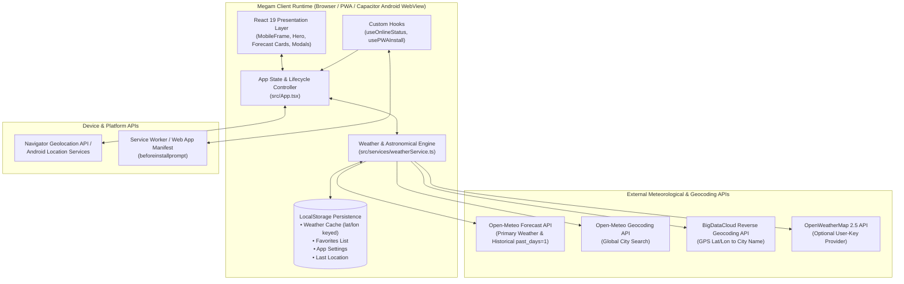
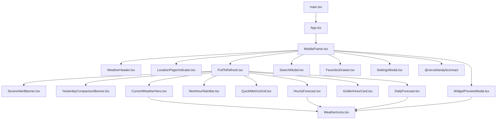
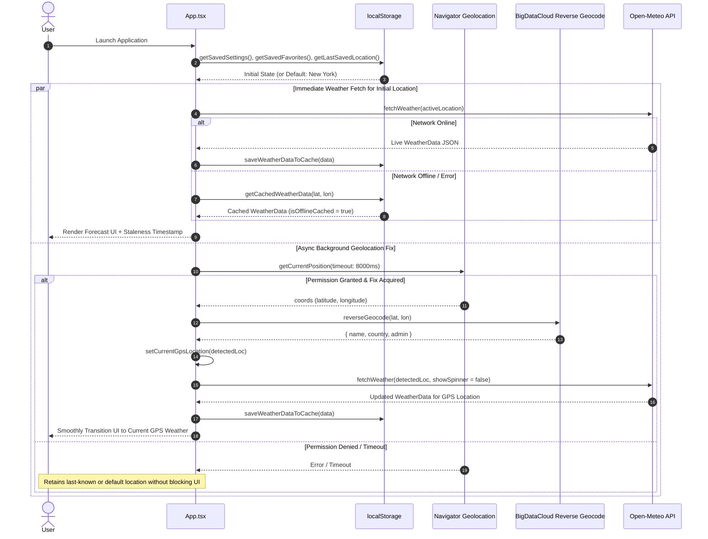
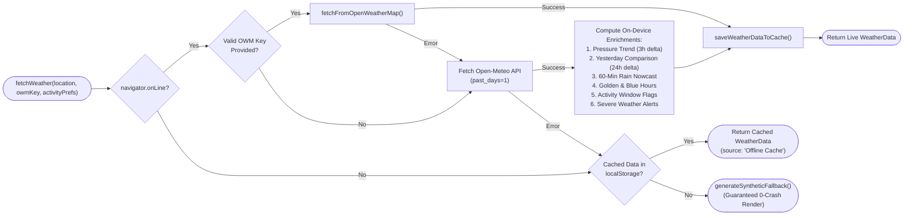

# Megam Weather (v2.0) — Architecture Documentation

**Version:** 2.0.1 (Build `2026.10.16.1`)  
**Specification Reference:** `docs/Megam - Weather App v2.0.docx`  
**Last Updated:** October 16, 2026

---

## 1. Architectural Overview

**Megam Weather** is a mobile-first, offline-capable, cross-platform weather application designed around three core architectural principles defined in the **PRD v2.0**:
1. **Instant Cache-First Startup (0ms Initial UI Render):** The application immediately hydrates from local storage (`localStorage` location-keyed snapshots) while asynchronously resolving device geolocation and live meteorological updates in the background.
2. **Simultaneous Dual-Unit Visual Hierarchy:** Metric (`°C`, `km/h`) and Imperial (`°F`, `mph`) units are computed at ingestion time and rendered side-by-side throughout the entire component tree without requiring re-fetches when switching the prominent primary unit.
3. **Zero-Bloat Client-Side Intelligence:** Value-add niche features—including **60-Minute Rain Nowcasting**, **Yesterday Comparison**, **Astronomical Golden/Blue Hour Windows**, **Barometric Pressure Trend Analysis**, and **Personalized Activity Window Matching**—are computed directly on-device with zero external server state or user tracking.

---

## 2. High-Level System Architecture

The system operates as a **100% client-side Single-Page Application (SPA)** packaged simultaneously as a **Progressive Web App (PWA)** deployed on **Vercel** and as a **Native Android Application (`com.megam.weather`)** powered by **Capacitor 8**.

---

## 3. Layered Architecture Breakdown

### 3.1 Presentation & Viewport Layer (`src/components/`)
- **Adaptive Viewport Container (`MobileFrame.tsx`):** Provides a responsive mobile canvas on native smartphones and an interactive device simulator (with toggleable *Mobile Device* `410×840px` frame vs. *Expanded View*) on desktop browsers. Dynamically adapts background gradients (`sunny`, `cloudy`, `rainy`, `storm`, `snow`, `night`) based on current WMO condition codes and day/night state.
- **Touch & Gesture Controllers:**
  - **Horizontal Location Pager (`App.tsx` + `LocationPagerIndicator.tsx`):** Tracks touch delta vectors (`|ΔX| > 70px` and `|ΔX| > 2 × |ΔY|`) to switch between Page `0` (Current GPS Location) and Pages `1..N` (Saved Favorite Locations), while isolating horizontal carousels (`HourlyForecast`, `NextHourRainBar`) via `data-no-page-swipe="true"` and event propagation guards.
  - **Pull-to-Refresh Container (`PullToRefresh.tsx`):** Applies logarithmic-style damping (`min(diff * 0.45, 90)`) with a `65px` activation threshold when scrolled to the top (`scrollTop === 0`).
- **Dual-Unit Visual Components:** Every temperature-bearing component (`CurrentWeatherHero`, `HourlyForecast`, `DailyForecast`, `WidgetPreviewModal`) receives `primaryUnit: 'C' | 'F'` and renders the primary unit at `100%` visual prominence alongside the secondary unit at `60%–70%` opacity.

### 3.2 Application State & Orchestration Layer (`src/App.tsx`)
`App.tsx` acts as the centralized controller managing:
- **Location Pager State:** `currentGpsLocation` (Page `0`), `favorites` (Pages `1..N`), and `activePageIndex`.
- **Weather Data Lifecycle:** Coordinates `isLoading`, `isRefreshing`, `isDetectingLocation`, `errorMessage`, and `weatherData`.
- **Theme Synchronization:** Reactively toggles the `.dark` class on `document.documentElement` based on `settings.theme` (`system`, `light`, `dark`) and `window.matchMedia('(prefers-color-scheme: dark)')`.
- **Background Pre-Fetch Scheduler:** Manages an optional `setInterval` timer (configurable to `15m`, `30m`, or `60m`, active only when `document.visibilityState === 'visible'`) when `settings.autoRefreshEnabled` is enabled.

### 3.3 Domain & Service Layer (`src/services/weatherService.ts`)
Encapsulates all external network I/O, data normalization, fallback chains, and on-device meteorological computations:
- **Provider Strategy & Fallback Chain:**
  1. **User-Configured OpenWeatherMap API** (if online and a valid key `> 10` chars is configured in Settings).
  2. **Open-Meteo Forecast API** (primary zero-key provider with `past_days=1` for 24-hour historical delta calculation).
  3. **Location-Keyed Offline Cache** (`megam_weather_cache_<lat>_<lon>` in `localStorage`).
  4. **Synthetic Offline Fallback Generator** (`generateSyntheticFallback`) guaranteeing the UI never crashes on first launch without connectivity.
- **On-Device Calculators:**
  - `calculateAstronomicalWindows()`: Computes Morning/Evening Blue and Golden Hours from daily sunrise/sunset timestamps.
  - `calculateNextHourRain()`: Synthesizes 5-minute interval precipitation intensity bars (`MinuteRainBar[]`) and human-readable nowcasting summaries.
  - **Yesterday Comparison Engine:** Compares current hour temperature and relative humidity against `nowIdx - 24` from the `past_days=1` hourly series.
  - **Barometric Pressure Trend Engine:** Calculates 3-hour surface pressure delta (`hPa`) at `nowIdx - 3` to classify atmospheric movement (`rising`, `steady`, `falling`).
  - **Activity Window Evaluator:** Evaluates each of the next 24 hours against user thresholds (`minTempC`, `maxTempC`, `maxWindKmh`, `maxPopPercent`).

### 3.4 Persistence & Caching Layer (`localStorage`)
All user preferences and weather snapshots are stored locally on the device:

| Storage Key | Type / Format | Purpose |
| :--- | :--- | :--- |
| `megam_weather_cache_<lat>_<lon>` | `WeatherData` (JSON) | Location-keyed weather snapshot rounded to 2 decimal places (`lat.toFixed(2)_lon.toFixed(2)`). |
| `megam_weather_last_loc` | `LocationInfo` (JSON) | Last resolved or selected location for instant `0ms` startup hydration. |
| `megam_weather_favorites` | `FavoriteLocation[]` (JSON) | User's saved favorite locations (defaults to Tokyo, London, New York on first run). |
| `megam_weather_settings` | `AppSettings` (JSON) | Primary unit, theme, alert toggle, auto-refresh config, OWM key, and activity thresholds. |

---

## 4. Component Hierarchy

---

## 5. Core Data Flows & Sequence Diagrams

### 5.1 Instant Cache-First Launch & Asynchronous GPS Refresh
Per **PRD v2.0 Section 10**, launching the app immediately loads the last saved location and its cached weather data while simultaneously requesting a fresh GPS coordinate fix in the background.

### 5.2 Weather Fetching & Multi-Tier Resilience Pipeline

---

## 6. Cross-Platform & Deployment Architecture

### 6.1 Web & PWA Architecture (Vercel Edge)
- **Bundler:** Vite 8 compiles TypeScript and Tailwind CSS v4 into static assets under `dist/`.
- **Routing & Edge Headers (`vercel.json`):**
  - Rewrites all SPA paths `/(.*)` to `/index.html`.
  - Serves `/manifest.json` with `Content-Type: application/manifest+json` and `Cache-Control: public, max-age=0, must-revalidate`.
  - Serves `/icon.svg` with immutable 1-year caching (`max-age=31536000, immutable`).
- **PWA Installation (`usePWAInstall.ts`):** Intercepts the browser `beforeinstallprompt` event on Android/Desktop Chrome and detects iOS Safari user agents to present step-by-step "Add to Home Screen" guidance inside `SettingsModal`.

### 6.2 Native Android Architecture (Capacitor 8)
- **Container (`android/`):** Wraps the compiled `dist/` web bundle inside a native Android WebView (`com.megam.weather.MainActivity`) using `androidScheme: 'https'`.
- **SDK Targets (`android/variables.gradle` & `android/app/build.gradle`):**
  - `applicationId`: `com.megam.weather`
  - `versionCode`: `2` / `versionName`: `"2.0.1"`
- **Permissions (`AndroidManifest.xml`):**
  - `android.permission.INTERNET`
  - `android.permission.ACCESS_COARSE_LOCATION`
  - `android.permission.ACCESS_FINE_LOCATION`

---

## 7. PRD v2.0 Architectural Alignment & Implementation Notes

A review of the current implementation against `docs/Megam - Weather App v2.0.docx` highlights the following architectural decisions and implementation nuances:

> [!NOTE]
> **Web/Hybrid Adaptation of Native Android PRD Concepts**
> While the PRD references several native Android primitives (such as Room/SQLite for yesterday's temperature cache, Android WorkManager for background sync, and Jetpack Glance for Material You widgets), the codebase implements a unified **React 19 + Capacitor 8 hybrid architecture**:
> - **Yesterday Comparison Storage:** Instead of requiring a full day of prior local SQLite caching before working, `weatherService.ts` queries Open-Meteo with `&past_days=1`, delivering immediate, accurate 24-hour historical comparisons on first visit for any city worldwide, and caches the resulting `YesterdayComparison` object in `localStorage`.
> - **Material You Home Screen Widgets:** Implemented as an interactive **Material You Widget Preview Simulator** (`WidgetPreviewModal.tsx`) showcasing `4×2` panoramic and `2×2` square dual-unit widgets. Native Jetpack Glance `AppWidgetProvider` classes are not yet registered in `AndroidManifest.xml`.
> - **Background Sync & Severe Alerts:** Foreground periodic pre-fetching is implemented via visibility-aware timers in `App.tsx`, and severe weather alerts are synthesized from real-time WMO codes (`>= 95` thunderstorm, `wind > 50 km/h`). Native Android `WorkManager` background workers and NWS alert endpoints are candidate enhancements for future native plugin expansion.

> [!IMPORTANT]
> **Privacy & Analytics Observation**
> Section 7 of the PRD specifies *"Zero Tracking: No user tracking, ad SDKs, or third-party analytics integrated."* Note that `src/App.tsx` currently mounts `<Analytics />` from `@vercel/analytics/react` (line 42 & line 496). For strict compliance with the PRD's Zero-Tracking mandate on web deployments, `<Analytics />` can be removed or gated behind an opt-in environment flag.
