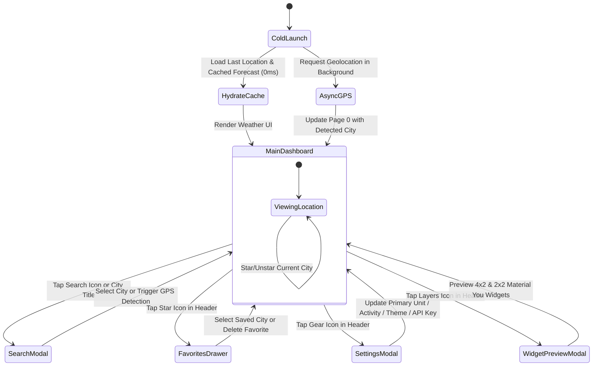

# Megam Weather (v2.0) — Functional Documentation

**Version:** 2.0.1 (Build `2026.10.16.1`)  
**Specification Reference:** `docs/Megam - Weather App v2.0.docx`  
**Last Updated:** October 16, 2026

---

## 1. Product Purpose & Overview

**Megam Weather** is a fast, lightweight, mobile-first weather application that delivers essential weather forecasts for a user's current GPS location and saved favorite cities. Designed for zero visual clutter and instant startup, Megam eliminates the need to toggle between Celsius and Fahrenheit by presenting **both metric and imperial units simultaneously** through a clear primary/secondary visual hierarchy.

---

## 2. Core Functional Modules

### 2.1 Top App Bar & Staleness Indicator (`WeatherHeader`)
- **Brand & Connectivity Status:** Displays the **Megam** brand title alongside a live data freshness indicator:
  - When online with fresh data: `"Updated just now"`, `"Updated 12m ago"`, `"Updated 2h ago"`, or `"Updated 1d ago"`.
  - When offline or viewing cached fallback data: Displays an amber **`Offline`** badge with a `WifiOff` icon.
- **Quick-Action Toolbar (44×44px accessible touch targets):**
  1. **Manual Refresh (`RefreshCw`):** Triggers an immediate forecast reload with a spinning animation.
  2. **Android Widgets Preview (`Layers`):** Opens the Material You Home Screen Widget simulator.
  3. **Location Search (`Search`):** Opens the global geocoding search modal.
  4. **Favorites Drawer (`Star`):** Opens the saved locations manager (displays an amber notification dot when favorites exist).
  5. **Settings (`Settings`):** Opens the application configuration modal.

### 2.2 Horizontal Swipeable Location Pager (`LocationPagerIndicator` & Gesture Canvas)
- **Page `0` (Current GPS Location):** Always pinned as the first pill with a navigation arrow icon. Defaults to the last viewed location (or New York on cold first boot) and automatically updates when device geolocation resolves.
- **Pages `1..N` (Favorite Locations):** Each saved favorite city appears as a selectable pill in the top horizontal pager bar. When more than 3 total locations exist, compact pagination dots render beside the pills.
- **Swipe Gestures:** Users can swipe left or right anywhere on the main weather canvas to cycle smoothly between their current location and saved favorites, or tap any pill directly.

### 2.3 Current Weather Hero (`CurrentWeatherHero`)
- **Location Header:** Displays the active city name and country/region. Tapping the city name opens the `SearchModal`. Beside the city name, a star button lets the user add or remove the current city from Favorites in one tap.
- **Condition Icon:** Large (`64px`) weather-adaptive vector icon inside a frosted glass badge.
- **Simultaneous Dual-Unit Temperature Display:**
  - **Primary Unit (`100%` prominence):** Rendered in `text-5xl font-extrabold` (`°C` by default, or `°F` if selected in Settings).
  - **Secondary Unit (`60%–70%` opacity):** Rendered simultaneously beside the primary temperature in `text-3xl font-bold` separated by a middle dot (`·`).
- **Condition & Unboxed Metadata:** Displays the capitalized condition description (e.g., *Partly cloudy*), dual-unit **Feels Like** temperature (e.g., `Feels like 20°C (68°F)`), and today's dual-unit **High / Low** range with color-coded up/down arrows (`↑ 23°C (73°F) / ↓ 13°C (55°F)`).

### 2.4 Quick Metrics Grid (`QuickMetricsGrid`)
A 2×2 glassmorphic card grid displaying four essential atmospheric metrics:
1. **Humidity:** Relative humidity percentage (`%`) with a water droplet icon.
2. **Wind Speed (Dual-Unit):** Simultaneous display of metric and imperial wind speed (`14 km/h · 8.7 mph`).
3. **Sunrise / Sunset:** Local solar rise and set times formatted in 12-hour `AM/PM` notation.
4. **Barometric Pressure & Trend Arrow:** Surface pressure in hectopascals (`hPa`) paired with a 3-hour trend indicator:
   - `↗ Rising` (Emerald) — *Rising (Clear skies)*
   - `↘ Falling` (Rose) — *Falling (Storm warning)*
   - `→ Steady` (Slate) — *Steady*

### 2.5 24-Hour Forecast & Activity Windows (`HourlyForecast`)
- **Horizontal Snap Carousel:** Displays the next 24 hours starting with `Now`.
- **Per-Hour Data:** Hour label, day/night condition icon, precipitation probability badge (shown when `> 0%`), primary temperature, and muted secondary temperature.
- **Activity Window Highlighting:** Hours that meet all user-configured outdoor comfort thresholds (temperature range, max wind speed, max rain probability) are highlighted with an emerald-tinted border/background and a pulsing green dot indicator (`Best Run / Walk / Ride Window`).

### 2.6 7-Day Forecast (`DailyForecast`)
- Displays a 7-row vertical forecast card starting with `Today`.
- Each row shows:
  - Day name (`Today`, `Wed`, `Thu`, ...) and weather condition subtitle.
  - Condition vector icon.
  - Precipitation probability percentage (displayed when `> 10%`).
  - Dual-unit daily High (`maxPrimary · maxSecondary`) and Low (`minPrimary · minSecondary`) temperatures formatted with tabular numerals for vertical alignment.

---

## 3. Value-Add Niche Features (PRD v2.0 Differentiators)

### 3.1 "Yesterday Comparison" Micro-Copy (`YesterdayComparisonBanner`)
- Positioned directly above the Current Weather Hero.
- Provides an instant, human-friendly comparison between the current hour and the exact same hour yesterday:
  - Example (cooler): `"Vs Yesterday: ↘ 4°C (7°F) cooler and less humid than yesterday"`
  - Example (warmer): `"Vs Yesterday: ↗ 3°C (5°F) warmer and noticeably more humid than yesterday"`
  - Example (similar): `"Vs Yesterday: − About the same temperature as yesterday (21°C · 70°F)"`

### 3.2 60-Minute Rain Bar — Next-Hour Nowcasting (`NextHourRainBar`)
- Replaces heavy, battery-draining radar map tiles with an ultra-lightweight 12-bar precipitation chart covering `Now`, `15m`, `30m`, `45m`, and `60m` in 5-minute increments.
- Color-codes bars by rainfall intensity (`Light` in sky blue, `Mod` in blue, `Heavy` in indigo, or muted slate when dry).
- Displays a concise nowcast summary in the card header (e.g., *"Dry conditions expected for the next 60 minutes"*, *"Light precipitation expected in ~15 minutes"*, or *"Heavy rain continuing over the next hour"*).

### 3.3 Golden Hour & Blue Hour Calculator (`GoldenHourCard`)
- Collapsible astronomical card tailored for photographers, runners, and walkers.
- **Collapsed State:** Shows a quick glance of today's **Evening Golden Hour** window.
- **Expanded State:** Reveals a 2×2 grid with exact local time ranges for:
  1. **Morning Golden Hour** (`12m before` to `45m after` sunrise)
  2. **Evening Golden Hour** (`45m before` to `12m after` sunset)
  3. **Morning Blue Hour** (`35m` to `12m before` sunrise)
  4. **Evening Blue Hour** (`12m` to `35m after` sunset)

### 3.4 Severe Weather Alert Banner (`SevereAlertBanner`)
- Renders at the top of the forecast view when `settings.severeAlertsEnabled` is `true` and active warnings/advisories are detected (e.g., WMO Thunderstorm codes `>= 95` or sustained high winds `> 50 km/h`).
- Supports **Expand/Collapse** to inspect full safety instructions and alert source attribution, or **Dismiss (`X`)** to hide for the current session.

### 3.5 Android Material You Widget Preview (`WidgetPreviewModal`)
- Accessible from the header's widget icon (`Layers`).
- Simulates Android home screen widgets using live weather data and the user's selected primary unit:
  - **4 × 2 Panoramic Widget:** Displays city name, side-by-side primary/secondary current temperatures, condition text, weather icon, and dual-unit daily High/Low arrows.
  - **2 × 2 Square Glance Widget:** Compact square layout displaying city name, icon, dual current temperatures, condition, and High/Low summary.
- Includes user instructions for pinning Megam widgets on Android.

---

## 4. User Workflows & Modals

### 4.1 Location Search Workflow (`SearchModal`)
1. User taps the **Search** icon in the header or taps the current **City Name** in the hero section.
2. User can tap **"Use Current GPS Location"** to force a fresh browser/device geolocation lookup, or type at least 2 characters into the search input.
3. Prior to typing, the modal displays 6 **Popular Cities** (Tokyo, London, New York, Paris, Sydney, Dubai) for one-tap selection.
4. While typing, global results from Open-Meteo Geocoding appear with city name, state/province (`admin1`), country, and rounded coordinates (`lat°, lon°`).
5. Selecting a city switches directly to its favorite page (if already saved) or loads it into Page `0`.

### 4.2 Favorites Management Workflow (`FavoritesDrawer`)
1. User taps the **Star** icon next to any city name in `CurrentWeatherHero` to toggle favorite status, or opens the **Favorites Drawer** from the top bar.
2. Inside the drawer, users can view their saved count, tap any favorite to jump directly to its forecast, or tap the trash icon (`Trash2`) to remove it.

### 4.3 Settings & Personalization Workflow (`SettingsModal`)
Users can customize all application behaviors with immediate persistence to `localStorage`:
- **Prominent Primary Unit:** Toggle between **Celsius (`°C`) Primary** and **Fahrenheit (`°F`) Primary**.
- **Activity Window Thresholds:**
  - Choose activity type: **Running 🏃**, **Walking 🚶**, or **Cycling 🚴**.
  - Set minimum and maximum ideal temperatures.
  - View maximum wind (`≤ 25 km/h`) and rain probability (`≤ 20%`) limits.
- **Appearance (Theme):** Choose **System**, **Light**, or **Dark** mode.
- **Severe Weather Alerts:** Toggle ON/OFF (Default: **ON**).
- **Periodic Background Pre-Fetch:** Toggle ON/OFF (Default: **OFF**). When enabled, reveals interval selector buttons for **15m**, **30m**, or **60m**.
- **OpenWeatherMap API Key (Optional):** Paste and save a personal OpenWeatherMap API key, or clear it to revert to Open-Meteo.
- **PWA Installation:** Displays an **"Install Megam on Android"** banner when installable via `beforeinstallprompt` (or an **"iOS Guide"** button on iPhone/iPad Safari).

---

## 5. Offline Behavior & Error Handling

1. **Real-Time Connectivity Detection (`useOnlineStatus`):** Listens to browser `online` and `offline` events.
2. **Offline Banner & Badge:** When offline or displaying cached data (`weatherData.isOfflineCached === true`), the header badge switches to **`Offline`** and an amber banner appears above the forecast: *"Offline Mode: Displaying last known cached forecast"*.
3. **Three-Tier Fallback Guarantee:**
   - **Tier 1 (Live API):** OpenWeatherMap (if key configured) $\rightarrow$ Open-Meteo API.
   - **Tier 2 (Location Cache):** Reads `megan_weather_cache_<lat>_<lon>` from `localStorage`.
   - **Tier 3 (Synthetic Fallback):** If a user launches the app completely offline for a location that has never been cached, `generateSyntheticFallback()` provides a safe baseline forecast marked as `Offline Cache` so the UI remains fully functional.

---

## 6. PRD v2.0 Requirements Traceability Matrix

| PRD Section & Requirement | Status | Implementation Reference |
| :--- | :--- | :--- |
| **2. Current Weather (Dual °C/°F, Feels Like, Humidity, Dual Wind, Pressure, Sunrise/Sunset)** | ✅ Implemented | `CurrentWeatherHero.tsx`, `QuickMetricsGrid.tsx`, `weatherService.ts` |
| **2. Dual-Unit Highs & Lows (Primary 100%, Secondary 60% opacity)** | ✅ Implemented | `CurrentWeatherHero.tsx` (L105–145), `DailyForecast.tsx` (L66–88) |
| **2. Hourly & 7-Day Forecast with Rain Probability (%)** | ✅ Implemented | `HourlyForecast.tsx`, `DailyForecast.tsx` |
| **2. Auto Location Detection + Manual Search + Horizontal Swipeable Pager** | ✅ Implemented | `App.tsx` (L99–142, L192–229), `LocationPagerIndicator.tsx`, `SearchModal.tsx` |
| **2. Lightweight Build (< 15MB)** | ✅ Implemented | Web bundle `< 300KB` gzipped; Android APK well under 15MB limit |
| **2. Offline Mode & Explicit Cache Staleness Timestamp** | ✅ Implemented | `weatherService.ts` (`formatStaleness`, cache functions), `WeatherHeader.tsx` |
| **2. Manual Pull-to-Refresh Gesture** | ✅ Implemented | `PullToRefresh.tsx` |
| **2. Settings: Primary Unit, Severe Alerts (Default ON), Background Pre-Fetch (Default OFF), Activity Thresholds, Theme** | ✅ Implemented | `SettingsModal.tsx`, `weatherService.ts` (`getSavedSettings`) |
| **3. "Yesterday Comparison" Micro-Copy** | ✅ Implemented | `YesterdayComparisonBanner.tsx`, `weatherService.ts` (L329–357) |
| **3. 60-Minute Rain Bar (Next-Hour Nowcasting)** | ✅ Implemented | `NextHourRainBar.tsx`, `weatherService.ts` (`calculateNextHourRain`) |
| **3. Golden Hour & Blue Hour Calculator (Client-Side Math)** | ✅ Implemented | `GoldenHourCard.tsx`, `weatherService.ts` (`calculateAstronomicalWindows`) |
| **3. Custom "Activity Windows" (Run / Walk / Bike Indicator)** | ✅ Implemented | `HourlyForecast.tsx` (L58–69), `SettingsModal.tsx` (L146–217) |
| **3. Barometric Pressure Trend Arrow (`↗` `↘` `→`)** | ✅ Implemented | `QuickMetricsGrid.tsx` (L10–37, L80–98), `weatherService.ts` (L319–327) |
| **3. Dual-Unit Home Screen Widgets (Material You)** | ⚠️ UI Simulator | `WidgetPreviewModal.tsx` (Interactive 4×2 & 2×2 preview modal; native Android Glance receiver pending) |
| **4. Dynamic Weather & Time-of-Day Background Gradients** | ✅ Implemented | `MobileFrame.tsx` (`getBackgroundGradient`) |
| **5. Transparent Data Source Attribution in Footer & Settings** | ✅ Implemented | `App.tsx` (L430–432), `SettingsModal.tsx` (L402–412) |
| **7. Zero Tracking & On-Device Location Privacy** | ⚠️ Partial | Location stays on-device for weather queries; `@vercel/analytics` is currently mounted in `App.tsx` |
| **10. Instant Cache-First Launch + Async Background GPS Update** | ✅ Implemented | `App.tsx` (L59–61, L187–234) |
