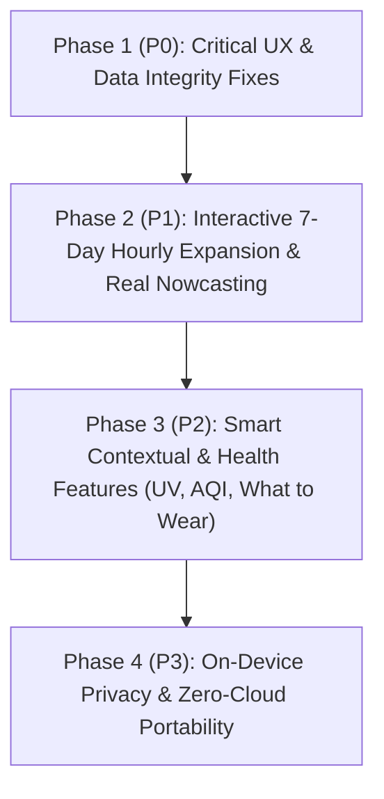

# Megam Weather — Product Implementation Plan

> [!NOTE]
> Per product direction, `@vercel/analytics` in [`App.tsx`](file:///c:/Users/Topgun/OneDrive/Projects/Megam-Reloaded/src/App.tsx#L496) is **retained**. All features below are designed to work 100% on-device with zero external user profiling or account requirements.

---

## Feature Priority Roadmap Overview

---

## Phase 1 (P0): Critical UX & Data Integrity Fixes

### 1. Activity Threshold Unit Conversion & Interactive Controls
* **Target Files:** [`SettingsModal.tsx`](file:///c:/Users/Topgun/OneDrive/Projects/Megam-Reloaded/src/components/SettingsModal.tsx#L180-L217), [`weatherService.ts`](file:///c:/Users/Topgun/OneDrive/Projects/Megam-Reloaded/src/services/weatherService.ts#L397-L425)
* **Problem:** When a user selects Fahrenheit (`°F`) as their Primary Unit, the Activity Window temperature inputs in Settings display `Ideal Temp (°F)` as the label, but still read and write raw Celsius values (`minTempC` / `maxTempC`). Additionally, `Max Wind` and `Max Rain` thresholds are static text (`≤ 25 km/h`, `≤ 20% rain`) rather than editable controls.
* **Implementation Details:**
  * Automatically convert and display `minTempC` / `maxTempC` in `°F` when `primaryUnit === 'F'`, converting back to Celsius on save.
  * Replace the static wind and rain text with interactive mobile-friendly steppers/sliders for `maxWindKmh` (showing `km/h · mph`) and `maxPopPercent` (`0%–100%`).

### 2. Explicit Offline State Instead of Silent Synthetic Weather
* **Target Files:** [`weatherService.ts`](file:///c:/Users/Topgun/OneDrive/Projects/Megam-Reloaded/src/services/weatherService.ts#L511-L516), [`App.tsx`](file:///c:/Users/Topgun/OneDrive/Projects/Megam-Reloaded/src/App.tsx#L444-L460)
* **Problem:** If a user is offline and searches for an uncached city, [`fetchWeather`](file:///c:/Users/Topgun/OneDrive/Projects/Megam-Reloaded/src/services/weatherService.ts#L515) falls back to [`generateSyntheticFallback`](file:///c:/Users/Topgun/OneDrive/Projects/Megam-Reloaded/src/services/weatherService.ts#L621), displaying fabricated `21°C / Mainly clear` weather labeled as `'Offline Cache'`.
* **Implementation Details:**
  * Only return cached data if a real cached entry exists in `localStorage` for that coordinate.
  * If no cache exists and the device is offline, throw a clear offline error so [`App.tsx`](file:///c:/Users/Topgun/OneDrive/Projects/Megam-Reloaded/src/App.tsx#L444-L460) renders an honest "No Offline Cache Available for [City]" state with a retry button.

---

## Phase 2 (P1): Core Forecast Upgrades & Interactive 7-Day Expansion

### 3. Interactive 7-Day Row Expansion (Horizontal Hourly Scroll)
* **Target Files:** [`types/weather.ts`](file:///c:/Users/Topgun/OneDrive/Projects/Megam-Reloaded/src/types/weather.ts#L74-L87), [`weatherService.ts`](file:///c:/Users/Topgun/OneDrive/Projects/Megam-Reloaded/src/services/weatherService.ts#L359-L438), [`DailyForecast.tsx`](file:///c:/Users/Topgun/OneDrive/Projects/Megam-Reloaded/src/components/DailyForecast.tsx)
* **User Story:** When tapping any day row in the 7-Day Forecast, that row smoothly expands to reveal a left-to-right horizontally scrollable 24-hour forecast strip for that specific day.
* **Implementation Details:**
  * **Data Layer ([`weatherService.ts`](file:///c:/Users/Topgun/OneDrive/Projects/Megam-Reloaded/src/services/weatherService.ts)):** Open-Meteo already returns 7 full days (168+ hours) of hourly data in `raw.hourly`. Group and attach each day's 24 hourly items (`HourlyForecast[]`) directly onto each [`DailyForecast`](file:///c:/Users/Topgun/OneDrive/Projects/Megam-Reloaded/src/types/weather.ts#L74-L87) object (`daily.hourly: HourlyForecast[]`).
  * **UI & Interaction ([`DailyForecast.tsx`](file:///c:/Users/Topgun/OneDrive/Projects/Megam-Reloaded/src/components/DailyForecast.tsx)):**
    * Add `expandedDate` state (`string | null`) so tapping a day toggles its expansion (with a subtle chevron indicator).
    * Render an inline horizontally scrollable strip (`overflow-x-auto snap-x snap-mandatory no-scrollbar`) inside the expanded day row, displaying each hour's time (`12 AM` .. `11 PM`), weather icon, precipitation probability (`%`), dual temperatures (`°C` / `°F`), and green optimal activity highlights.
    * Add `data-no-page-swipe="true"` and touch propagation guards (`onTouchStart` / `onTouchMove` / `onTouchEnd` stopPropagation) on the horizontal scroll container so scrolling a future day's hourly forecast never triggers the main screen's location pager swipe.

### 4. Destination Local Time Clock in Hero Header
* **Target Files:** [`types/weather.ts`](file:///c:/Users/Topgun/OneDrive/Projects/Megam-Reloaded/src/types/weather.ts#L98-L110), [`weatherService.ts`](file:///c:/Users/Topgun/OneDrive/Projects/Megam-Reloaded/src/services/weatherService.ts#L289-L293), [`CurrentWeatherHero.tsx`](file:///c:/Users/Topgun/OneDrive/Projects/Megam-Reloaded/src/components/CurrentWeatherHero.tsx#L60-L95)
* **User Story:** When swiping between saved cities across timezones (e.g., Tokyo, London, New York), users immediately see the destination's local time and day/night context.
* **Implementation Details:**
  * Capture `utc_offset_seconds` and `timezone` from the Open-Meteo response.
  * Display a subtle pill or subtitle in [`CurrentWeatherHero.tsx`](file:///c:/Users/Topgun/OneDrive/Projects/Megam-Reloaded/src/components/CurrentWeatherHero.tsx) showing `Local time · 11:42 AM` (when viewing a non-local timezone or for all cities).

### 5. Real 15-Minute Nowcasting Data for the 60-Minute Rain Bar
* **Target Files:** [`weatherService.ts`](file:///c:/Users/Topgun/OneDrive/Projects/Megam-Reloaded/src/services/weatherService.ts#L140-L189), [`NextHourRainBar.tsx`](file:///c:/Users/Topgun/OneDrive/Projects/Megam-Reloaded/src/components/NextHourRainBar.tsx)
* **User Story:** Replace the synthetic sine-wave precipitation curve with actual high-resolution nowcasting data from Open-Meteo where available, and clearly badge estimated interpolations.
* **Implementation Details:**
  * Request `minutely_15=precipitation` in the Open-Meteo forecast query.
  * Interpolate the next four 15-minute intervals into the 5-minute bar slots when real minutely data is returned, and display a `"Live Radar Nowcast"` vs. `"Hourly Trend Estimate"` badge in [`NextHourRainBar.tsx`](file:///c:/Users/Topgun/OneDrive/Projects/Megam-Reloaded/src/components/NextHourRainBar.tsx).

---

## Phase 3 (P2): Smart Contextual & Health Features

### 6. "What to Wear / Bring" Contextual Recommendation Strip
* **Target Files:** `src/components/WhatToWearStrip.tsx` (New), [`App.tsx`](file:///c:/Users/Topgun/OneDrive/Projects/Megam-Reloaded/src/App.tsx)
* **User Story:** Provide 2–3 instant, actionable decision chips right below [`CurrentWeatherHero`](file:///c:/Users/Topgun/OneDrive/Projects/Megam-Reloaded/src/components/CurrentWeatherHero.tsx) so users know what to grab before walking out the door.
* **Implementation Details:**
  * 100% deterministic, on-device rule engine evaluating the next 6 hours of forecast data:
    * **Umbrella Alert:** `☂️ Bring an umbrella (Rain likely at 3 PM)` if POP $\ge 45\%$ in the next 6 hours.
    * **Layering / Jacket Advice:** `🧥 Light jacket (Drops to 11°C / 52°F this evening)` if temperature drops $\ge 5^\circ\text{C}$ before 10 PM.
    * **UV / Sun Protection:** `🕶️ Sunglasses & SPF (UV 7 at 1 PM)` when peak UV $\ge 6$.
    * **Wind / Hydration:** Contextual callouts for high gusts ($\ge 35\text{ km/h}$) or high heat/humidity.

### 7. UV Index & Air Quality (US AQI / PM2.5) Integration
* **Target Files:** [`types/weather.ts`](file:///c:/Users/Topgun/OneDrive/Projects/Megam-Reloaded/src/types/weather.ts), [`weatherService.ts`](file:///c:/Users/Topgun/OneDrive/Projects/Megam-Reloaded/src/services/weatherService.ts), [`QuickMetricsGrid.tsx`](file:///c:/Users/Topgun/OneDrive/Projects/Megam-Reloaded/src/components/QuickMetricsGrid.tsx), [`SettingsModal.tsx`](file:///c:/Users/Topgun/OneDrive/Projects/Megam-Reloaded/src/components/SettingsModal.tsx)
* **User Story:** Runners, cyclists, and parents need to know if UV radiation or wildfire smoke / air pollution makes outdoor activity unsafe, even when temperature and wind look ideal.
* **Implementation Details:**
  * Add `uv_index` to the Open-Meteo forecast query and fetch `us_aqi,pm2_5` from `https://air-quality-api.open-meteo.com/v1/air-quality` in parallel.
  * Add **UV Index** (with Low/Mod/High/Very High color badge) and **Air Quality (AQI)** cards to [`QuickMetricsGrid.tsx`](file:///c:/Users/Topgun/OneDrive/Projects/Megam-Reloaded/src/components/QuickMetricsGrid.tsx).
  * Factor AQI ($\le 100$ default) and UV Index into the **Optimal Activity Window** calculation so smoky or extreme-UV hours are not marked as green optimal workout windows.

---

## Phase 4 (P3): On-Device Privacy & Zero-Cloud Portability

### 8. Coordinate Privacy Fuzzing ("Neighborhood-Only GPS" Mode)
* **Target Files:** [`SettingsModal.tsx`](file:///c:/Users/Topgun/OneDrive/Projects/Megam-Reloaded/src/components/SettingsModal.tsx), [`weatherService.ts`](file:///c:/Users/Topgun/OneDrive/Projects/Megam-Reloaded/src/services/weatherService.ts), [`App.tsx`](file:///c:/Users/Topgun/OneDrive/Projects/Megam-Reloaded/src/App.tsx#L192-L229)
* **User Story:** Ensure the user's exact home or office street address coordinates are never transmitted over the network to weather or reverse-geocoding APIs.
* **Implementation Details:**
  * Round detected GPS coordinates to 2 decimal places (`lat = Math.round(lat * 100) / 100`, `~1.1 km` neighborhood resolution) on-device immediately upon `navigator.geolocation.getCurrentPosition` resolution.
  * Add a toggle in [`SettingsModal.tsx`](file:///c:/Users/Topgun/OneDrive/Projects/Megam-Reloaded/src/components/SettingsModal.tsx) (enabled by default) with a privacy badge explaining that exact coordinates never leave the device.

### 9. Zero-Cloud Favorites & Settings Backup (Import / Export / Share)
* **Target Files:** [`SettingsModal.tsx`](file:///c:/Users/Topgun/OneDrive/Projects/Megam-Reloaded/src/components/SettingsModal.tsx)
* **User Story:** Because Megam uses zero user accounts or cloud databases, users need an effortless way to back up or transfer their favorite cities, activity preferences, and API keys to a new phone.
* **Implementation Details:**
  * Add **Export Configuration** (copies a compact base64/JSON string or downloads `megam-backup.json`) and **Import Configuration** directly inside [`SettingsModal.tsx`](file:///c:/Users/Topgun/OneDrive/Projects/Megam-Reloaded/src/components/SettingsModal.tsx).

---

## Summary Execution Order

| Order | Feature | Phase | Primary Files Affected |
| :---: | :--- | :---: | :--- |
| **1** | Activity Threshold `°F`/`°C` Fix & Wind/Rain Sliders | P0 | [`SettingsModal.tsx`](file:///c:/Users/Topgun/OneDrive/Projects/Megam-Reloaded/src/components/SettingsModal.tsx), [`weatherService.ts`](file:///c:/Users/Topgun/OneDrive/Projects/Megam-Reloaded/src/services/weatherService.ts) |
| **2** | Honest Offline Empty State (Remove Fake Weather Fallback) | P0 | [`weatherService.ts`](file:///c:/Users/Topgun/OneDrive/Projects/Megam-Reloaded/src/services/weatherService.ts), [`App.tsx`](file:///c:/Users/Topgun/OneDrive/Projects/Megam-Reloaded/src/App.tsx) |
| **3** | **Interactive 7-Day Row Expansion (Horizontal Hourly Scroll)** | P1 | [`DailyForecast.tsx`](file:///c:/Users/Topgun/OneDrive/Projects/Megam-Reloaded/src/components/DailyForecast.tsx), [`weatherService.ts`](file:///c:/Users/Topgun/OneDrive/Projects/Megam-Reloaded/src/services/weatherService.ts), [`weather.ts`](file:///c:/Users/Topgun/OneDrive/Projects/Megam-Reloaded/src/types/weather.ts) |
| **4** | Destination Local Time Clock in Hero Header | P1 | [`CurrentWeatherHero.tsx`](file:///c:/Users/Topgun/OneDrive/Projects/Megam-Reloaded/src/components/CurrentWeatherHero.tsx), [`weatherService.ts`](file:///c:/Users/Topgun/OneDrive/Projects/Megam-Reloaded/src/services/weatherService.ts) |
| **5** | Real 15-Minute Nowcasting in 60-Minute Rain Bar | P1 | [`NextHourRainBar.tsx`](file:///c:/Users/Topgun/OneDrive/Projects/Megam-Reloaded/src/components/NextHourRainBar.tsx), [`weatherService.ts`](file:///c:/Users/Topgun/OneDrive/Projects/Megam-Reloaded/src/services/weatherService.ts) |
| **6** | "What to Wear / Bring" Contextual Recommendation Strip | P2 | `WhatToWearStrip.tsx`, [`App.tsx`](file:///c:/Users/Topgun/OneDrive/Projects/Megam-Reloaded/src/App.tsx) |
| **7** | UV Index & Air Quality (AQI) Cards + Activity Filter | P2 | [`QuickMetricsGrid.tsx`](file:///c:/Users/Topgun/OneDrive/Projects/Megam-Reloaded/src/components/QuickMetricsGrid.tsx), [`weatherService.ts`](file:///c:/Users/Topgun/OneDrive/Projects/Megam-Reloaded/src/services/weatherService.ts) |
| **8** | On-Device Coordinate Privacy Fuzzing (`~1.1 km` rounding) | P3 | [`App.tsx`](file:///c:/Users/Topgun/OneDrive/Projects/Megam-Reloaded/src/App.tsx), [`SettingsModal.tsx`](file:///c:/Users/Topgun/OneDrive/Projects/Megam-Reloaded/src/components/SettingsModal.tsx) |
| **9** | Zero-Cloud Settings & Favorites Import/Export | P3 | [`SettingsModal.tsx`](file:///c:/Users/Topgun/OneDrive/Projects/Megam-Reloaded/src/components/SettingsModal.tsx) |
